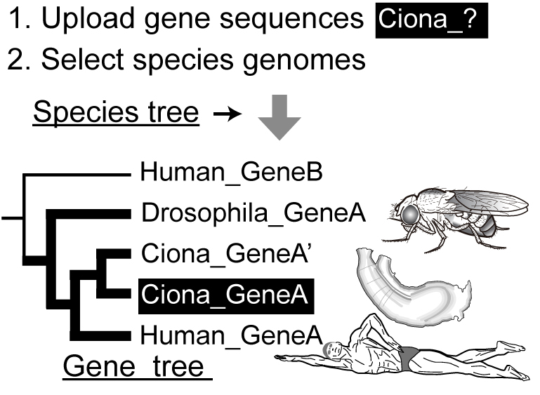

# ORTHOSCOPE

<!-- 
## NEWS
Mirror viento has been accidentally stopped on 19 Jan 2024 morning. Please use Mirror Osaka until recovery of viento.
-->

## Web Servers for Online Analysis
yurai (fast)   
[http://yurai.aori.u-tokyo.ac.jp/orthoscope/Deuterostomia.html](http://yurai.aori.u-tokyo.ac.jp/orthoscope/Deuterostomia.html)    
<!-- 
viento (mediam)   
[https://orthoscope.jp/orthoscope/Deuterostomia.html](https://orthoscope.jp/orthoscope/Deuterostomia.html)   
 This server will close soon (1 Feb 2025)   
-->

osaka2 (slow)   
[http://49.212.178.185/orthoscope/Deuterostomia.html](http://49.212.178.185/orthoscope/Deuterostomia.html)

---
## Instruction　　　
[https://fish-evol.org/orthoscope_instruction/index.html](https://fish-evol.org/orthoscope_instruction/index.html)   

---

[Original publication](https://academic.oup.com/mbe/article/36/3/621/5229933)

---
## Contact 
Email: [_jinoueATg.ecc.u-tokyo.ac.jp_](http://www.fish-evol.org/index_eng.html)
